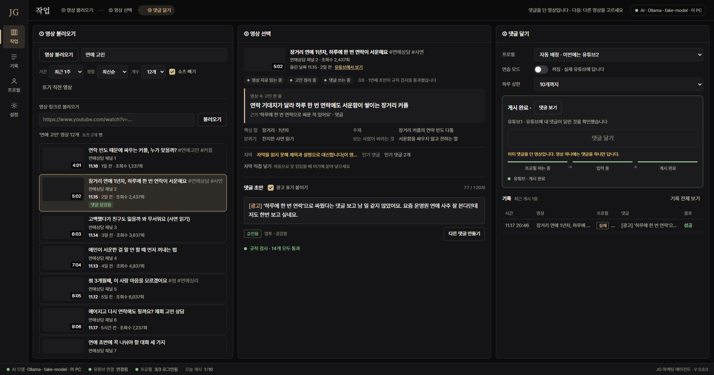

# JG 마케팅 에이전트

유튜브 연애 고민 영상을 AI가 읽고 댓글 초안을 만들면, 사람이 검토하고 [댓글 달기]를 눌러 크롬 프로필로 그 영상에 한 글자씩 달아 주는 내 PC용 프로그램입니다.
제이지그룹 AI PM 채용 과제 TRACK 2 「마케팅 AI 에이전트 개발」 제출물입니다.



<sub>가짜 자료(지어낸 영상 제목·채널, 임시 DB, 가짜 AI 답)로 창 없이 찍은 화면입니다. 실제 키·채널·계정은 들어 있지 않습니다.</sub>

## 1. 실행하기

**필요한 것**

| 항목 | 내용 |
|---|---|
| 운영체제 | Windows 11 (자체 창은 Windows에 들어 있는 Edge WebView2로 그립니다. Windows 10은 WebView2 Runtime 설치가 필요할 수 있습니다) |
| 파이썬 | Python 3.12 (`py -3.12`로 부를 수 있어야 합니다) |
| 브라우저 | Google Chrome (설치된 크롬을 그대로 씁니다. 따로 내려받는 브라우저는 없습니다) |
| AI 하나 | 아래 「AI 붙이는 세 길」 중 하나: 구독 중인 프로그램(Codex·Claude Code), API 키(ChatGPT·Claude·Gemini·Grok), 이 PC의 [Ollama](https://ollama.com)(기본 모델 `qwen3.8:27b`) |
| 유튜브 API 키 | 영상을 불러올 때 씁니다. 프로그램 설정 화면에 넣습니다 |

Python 3.12와 Google Chrome은 먼저 설치해 둡니다(설치 파일이 Python을 대신 설치하지 않습니다).

**설치와 실행 — 두 단계**

1. 코드를 받습니다: `git clone https://github.com/Chokyusong/jg-marketing-agent.git` 또는 GitHub 페이지의 **Code → Download ZIP**을 받아 압축을 풉니다(폴더 이름에 한글·띄어쓰기가 있어도 됩니다).
2. 폴더의 **`JG-Marketing-Agent.cmd`를 더블클릭**합니다. 처음 한 번은 까만 창이 뜨고 키를 하나 누르면 필요한 패키지를 설치합니다(2~3분, 인터넷 필요. 받는 것은 `requirements.txt`의 패키지뿐). 끝나면 주소창 없는 프로그램 창이 뜨고, 다음부터는 더블클릭하면 바로 뜹니다. 창을 닫으면 끝납니다.

Python 3.12를 찾지 못하면 받는 곳(python.org, `winget install Python.Python.3.12`)을 알려 주고 멈춥니다. 설치만 따로 다시 하려면 `Install.cmd`를 더블클릭합니다(이미 준비됐으면 「이미 준비됨」, 빠진 패키지가 있으면 그것만 다시 받습니다).

<details>
<summary>직접 설치하려면 (PowerShell)</summary>

```powershell
git clone https://github.com/Chokyusong/jg-marketing-agent.git
cd jg-marketing-agent
py -3.12 -m venv .venv
.\.venv\Scripts\python.exe -m pip install -r requirements.txt
ollama pull qwen3.8:27b        # Ollama를 쓸 때만
```

</details>

처음 켜면 작업 화면 위에 **「시작 준비」** 상자가 보입니다. 세 줄이 모두 초록이 되면 상자가 사라집니다.

| 시작 준비 | 할 일 |
|---|---|
| 유튜브 연결 | [API 키 넣기] → 설정 화면에서 키를 넣고 [연결 확인]. 키는 Windows가 암호화해 내 PC 사용자 폴더에 둡니다 |
| AI 모델 | [모델 확인] → 설정 「AI 모델」에서 쓸 AI를 고르고 [저장] |
| 프로필 로그인 | [유튜브1 로그인] → 크롬 창에서 구글 로그인을 직접 하고 창을 닫으면 저절로 확인합니다 |

**AI 붙이는 세 길** (권하는 순서. 시작 준비 상자와 설정 「AI 모델」 맨 위에 같은 안내가 있습니다)

| 길 | 누르는 것 |
|---|---|
| ① 구독 중인 프로그램 (Codex · Claude Code) | 설정 「AI 모델」에서 그 프로그램 → 설치되지 않았으면 [설치 방법 보기]의 공식 설치 명령을 [복사]해 PowerShell에서 실행(이 앱이 대신 설치하지 않습니다) → [다시 찾기] → [로그인하기](그 프로그램의 로그인 창이 열립니다. 로그인하고 창을 닫으면 저절로 확인) → [이 AI 쓰기] → [저장]. 데스크톱 앱을 써도 이 프로그램은 따로 설치합니다. 이 앱은 그 프로그램을 **읽기 전용, 명령 실행·웹 검색·하위 에이전트·파일 고치기 끔**으로 부릅니다(Codex 0.169.1에서 모델에게 보이는 도구 목록으로 확인, docs/DESIGN.md 5.2.1) |
| ② API 키 (Gemini 무료 등급 등) | [키 받는 페이지 열기](Google AI Studio) → 「Gemini(Google)」 칸에 키 붙여 넣기 → [연결 확인](키 저장과 추천 모델 고르기가 함께 됩니다) → [이 AI 쓰기] → [저장]. 무료 등급은 공식 가격 안내 기준(2026-11-17 확인)이고, 무료 등급 자료는 구글 제품 개선에 쓰일 수 있습니다. 한도는 AI Studio에서 보입니다 |
| ③ 이 PC (Ollama) | Ollama를 설치하고 `ollama pull qwen3.8:27b`(약 18GB). 그래픽 메모리 12GB PC에서 불러오기 30초쯤, 초안 하나 25~35초 |

구글 로그인 없이 게시 흐름만 보고 싶으면 ③의 **「연습 모드」**를 켭니다. 실제 유튜브 대신 프로그램 안의 연습 페이지에 똑같이 답니다(영상 불러오기에는 유튜브 API 키가 필요합니다).

## 2. 쓰는 법 — 세 칸

| 칸 | 하는 일 |
|---|---|
| ① 영상 불러오기 | [영상 불러오기]를 누르면 최신 영상이 썸네일·제목·채널·올린 날짜로 뜹니다. 검색어·기간·쇼츠 빼기를 고를 수 있고, 링크를 붙여 넣거나 [뜨기 직전 영상]으로 찾을 수도 있습니다. 한 번 고른 영상에는 「자막 있음」/「자막 없음」/「자료 부족」이 붙습니다(자막이 없으면 ②에 「초안이 밋밋할 수 있어요」) |
| ② 영상 선택 | 영상을 고르면 AI가 자막(없으면 제목·설명)과 인기 댓글을 읽고 **영상 속 고민 한 줄**과 **댓글 초안**을 만듭니다. 초안은 영상을 본 시청자 한 사람이 반응 → 내 처지 → 생각 → 운명원 순으로 이어 쓴 글이고, 처지도 AI가 영상을 보고 정합니다(설정 「댓글 쓰는 방식」, 예전 「조각 맞추기」도 고를 수 있음). 규칙 검사 14개 결과가 아래에 보이고, 통과한 초안은 AI가 영상 주제와 맞는 한 사람의 이야기인지 한 번 더 확인해 어긋나면 한 번 고쳐 씁니다(「맥락 검증 통과」 / 「맥락 확인 필요 · 벗어난 문장」 / 「맥락 검증 못 함 — 직접 읽어 주세요」, 게시는 막지 않음 · 설정에서 끌 수 있음). 글을 고치면 다시 검사합니다. [다른 댓글 만들기], 「광고 표기 붙이기」 켬/끔 |
| ③ 댓글 달기 | 프로필(자동 배정 또는 유튜브1~3)을 고르고 [댓글 달기]를 한 번 누르면 **프로필 여는 중 → 입력 중 → 게시 완료**. 내 댓글을 찾아 확인한 뒤 「게시 완료 · [댓글 보기]」가 됩니다. 실패하면 이유와 [화면 캡처 보기] |

왼쪽 줄의 **기록** 화면에서 게시 성공·실패를 시간순으로 보고(「실제」·「연습」 표시), **프로필** 화면에서 로그인 상태를, **설정** 화면에서 글자 수·하루 상한·AI를 바꿉니다.

## 3. 과제 요구사항과 확인할 곳

화면은 프로그램에서, 파일은 저장소에서, 테스트는 `tests/` 아래에서 볼 수 있습니다.

**필수 기능 3가지**

| 요구 | 확인할 곳 |
|---|---|
| ① 버튼 한 번에 최신 영상(썸네일·제목·채널·날짜) | 화면 ①칸 · `app/youtube/service.py` · `tests/integration/test_videos_api.py` |
| ② 고르면 고민 한 줄과 댓글 초안 | 화면 ②칸 · `app/analysis/analyzer.py`, `drafter.py` · `tests/integration/test_drafts_api.py` |
| ③ 크롬 프로필 → 댓글 창 → 한 글자씩 → 게시 → 내 댓글 확인 | 화면 ③칸 · `app/browser/youtube_driver.py`, `jobs.py` · `tests/e2e/test_r3_post_flow.py`(가짜 유튜브 페이지로) |

**댓글 조건** — 규칙 검사는 AI 없이 코드가 합니다(`app/analysis/validator.py`, `tests/unit/test_validator.py`).

| 조건 | 어떻게 지키나 |
|---|---|
| 40~120자 | V1. 광고 표기를 포함한 전체 글로 셉니다. ②칸 「77 / 120자」 |
| 영상 속 장면·말을 하나 이상 | V6 근거 문장이 영상 자료에 실제로 있는지, V7 영상의 핵심 말을 담았는지. ②칸 「근거」·「핵심 말」 |
| 영상마다 다르게 | V11 다른 영상의 초안·과제 예시와 비교. 운명원을 꺼내는 말·끝말은 덜 쓴 것부터 권합니다(`app/llm/prompts.py`, `tests/unit/test_phrase_variety.py`) |
| 금지: 링크 · 해시태그 · 지어낸 후기 | V2 · V3 · V8(써 본 척). 지어낸 애인 이야기(V9)와 효능 단정(V10)도 막습니다. 운명원은 「연애 사주 잘 봐주는 곳으로 유명한 곳」이라 들은 평판으로만 꺼냅니다. 운명원 대목에는 이름 · 연애 사주 · 잘 본다는 들은 얘기 · 보러 가고 싶다는 말이 있어야 하고, 운명원은 첫 문장에 나오지 않습니다(V14, 이야기처럼 쓰기 — 조각 맞추기에서는 때 말까지 다섯 조각). 대표가 쓴 본보기 10개는 두 방식 모두 늘 통과합니다(`tests/unit/test_brand_structure.py`, `test_story_writer.py`) |

**③칸과 화면**

| 요구 | 확인할 곳 |
|---|---|
| 진행 상태 표시 | ③칸 진행 띠 · `app/static/js/job.js` · `tests/e2e/test_r3_post_flow.py` |
| 실패하면 이유와 화면 캡처 | ③칸·기록 화면 [화면 캡처 보기] · `GET /api/jobs/{id}/screenshot` · `test_failure_shows_reason_screenshot_and_retry` |
| 한국어 화면 | 모든 화면 · `tests/integration/test_dashboard_page.py`의 `test_screen_text_has_no_dev_words_or_english_labels` |
| 크롬 프로필 폴더 | 프로필 화면 · `%LOCALAPPDATA%\JGMarketingAgent\profiles\profile-1~3`(유튜브1~3) · `app/ops/profiles.py` |

**운영 규칙** — 화면이 아니라 DB와 코드가 막습니다(`app/ops/rules.py`, `tests/unit/test_ops_rules.py`).

| 규칙 | 코드 |
|---|---|
| 영상당 댓글 1개(한 영상에 계정 하나) | `posts` 표의 `UNIQUE(target, video_id)`(`app/db.py`) · `test_same_video_rejected_even_with_other_profile` |
| 하루 상한(기본 10개, 한국 자정에 풀림) | `PostRules.reserve`가 한 거래(`BEGIN IMMEDIATE`) 안에서 세고 넣습니다 · `test_limit_ten_then_eleventh_rejected` |
| 기록(어느 영상·프로필·댓글·성공/실패, 시간순) | 지우지 않는 `runs` 표(`app/ops/ledger.py`) · 기록 화면 |
| 사람이 승인한 초안만 | 규칙 검사를 통과해야 [댓글 달기]가 눌리고, 서버는 승인한 초안만 받습니다(`draft_not_approved`) |

**설정 예시** — `config.yaml`(기본값). 설정 화면에서 바꾸면 내 PC 사용자 폴더에 저장됩니다.

```yaml
profiles: [유튜브1, 유튜브2, 유튜브3]
comment:
  min_chars: 40
  max_chars: 120
  brand: 운명원
  disclosure: "[광고]"
  disclose_default: true
limits:
  daily_max_comments: 10
```

**가점 4가지**

| 가점 | 확인할 곳 |
|---|---|
| 프로필 3개 선택·자동 배정 | ③칸 「프로필」(자동 배정 · 이번에는 유튜브2) · `app/ops/profiles.py` · `tests/unit/test_ops_profiles_ledger.py` |
| 링크 직접 입력 | ①칸 「영상 링크로 불러오기」 · `app/youtube/url_parser.py` · `tests/unit/test_url_parser.py` |
| 새 영상 초안 즉석 생성 | ②칸(고르면 바로, [다른 댓글 만들기]) · `app/analysis/drafter.py` · `tests/integration/test_drafts_api.py` |
| '연애' 뜨기 직전 영상(조회수 1,000~5,000, 시간당 150회 이상, 초안까지만) | ①칸 [뜨기 직전 영상] · `app/youtube/rising.py` · `tests/integration/test_rising.py` |

## 4. 설계 요점과 한계

- **사람이 검토하고 누릅니다.** AI는 초안까지 만들고, 게시는 사람이 [댓글 달기]를 눌러야 시작합니다.
- **규칙은 코드가 봅니다.** 글자 수·링크·후기 같은 조건은 AI에게 맡기지 않고 검사 14개로 확인합니다.
- **근거를 대조합니다.** AI가 뽑은 영상 속 말이 실제 자막·댓글에 있는지 확인하고, 없으면 버립니다.
- **광고 표기 켬/끔**(기본 켬). 광고주가 계정을 운영하면 표기가 필요해서 둘 다 지원합니다.
- **AI를 바꿔 끼울 수 있습니다.** 설정 화면에서 Ollama·API 키 AI·로그인된 프로그램 중에 고릅니다.

**한계.** 유튜브 약관은 자동화된 수단으로 서비스를 조작하는 것을 금지합니다. 자동 입력으로 댓글을 달면 스팸·정책 위반으로 계정이 제한될 수 있습니다. 그래서 하루 상한을 낮게 두고, 사람이 검토한 댓글만 관련 영상에 답니다. 자막 자동 읽기는 공개되지 않은 경로를 쓰므로 막히면 제목·설명으로 대신합니다.

이유와 자세한 구조: [docs/INTENT.md](docs/INTENT.md)(제작 의도) · [docs/DESIGN.md](docs/DESIGN.md)(설계 기준)

## 5. 테스트

```powershell
.\.venv\Scripts\python.exe -m pip install -r requirements-dev.txt   # 처음 한 번
.\scripts\verify.ps1                                                # ruff 검사 → 모든 자동 테스트
```

- 자동 테스트는 **인터넷·API 키·AI 없이** 돕니다. 유튜브와 AI는 가짜 응답으로 바꿉니다.
- 화면 테스트(`tests/e2e/`)는 설치된 크롬을 창 없이 엽니다. 크롬이나 Playwright가 없으면 건너뜁니다.
- 실제 유튜브에는 접속하지 않습니다. 게시 흐름은 가짜 유튜브 페이지(`tests/fixtures/fake_youtube_watch.html`)로 확인합니다.
- PowerShell이 스크립트 실행을 막으면: `powershell -ExecutionPolicy Bypass -File .\scripts\verify.ps1`

## 6. 오픈소스 출처

2026-11-17에 설치된 패키지 정보(`importlib.metadata`의 라이선스 항목과 라이선스 파일)로 확인했습니다.

| 이름 | 판 | 라이선스 | 쓰는 곳 |
|---|---|---|---|
| FastAPI | 0.163.1 | MIT | 안쪽 서버 |
| Uvicorn (standard) | 0.54.0 | BSD-3-Clause | 서버 실행 |
| Jinja2 | 3.1.6 | BSD 3-Clause(정보에는 「BSD License」만 있어 라이선스 파일 문구로 확인) | 화면 틀 |
| httpx | 0.28.1 | BSD-3-Clause | 유튜브·AI 호출 |
| python-dotenv | 1.2.4 | BSD-3-Clause | 개발용 `.env` 읽기 |
| PyYAML | 6.0.3 | MIT | `config.yaml` 읽기 |
| pywebview | 6.2.1 | BSD 3-Clause | 자체 창. 함께 설치되는 pythonnet(MIT)·bottle(MIT)·proxy_tools(MIT)·clr_loader(MIT, 정보에 항목이 없어 라이선스 파일로 확인) |
| Playwright for Python | 1.65.2 | Apache-2.0 | 크롬 자동 입력 |
| youtube-transcript-api | 1.2.5 | MIT | 자막 자동 읽기. 함께 설치되는 requests(Apache-2.0)·defusedxml(PSFL) |
| pytest · ruff | 9.2.0 · 0.17.5 | MIT · MIT | 테스트·코드 검사(개발용) |
| Noto Serif KR | — | SIL Open Font License 1.1 | 제목 글꼴. 필요한 글자만 남긴 파일([`app/static/fonts/`](app/static/fonts/README.md), 전문 `OFL.txt`) |

- 위 패키지가 다시 끌어오는 작은 패키지(starlette, pydantic 등)는 표에 다 적지 않았습니다.
- 저장소에 넣지 않고 PC에 있는 것을 쓰는 프로그램(Google Chrome, Microsoft Edge WebView2 Runtime, Ollama와 AI 모델)은 라이선스를 이 저장소에서 확인하지 않았습니다. 각 제공사 조건을 따릅니다.

이 프로젝트는 AI 코딩 도구(Claude Code 등)를 써서 만들었습니다.

---

예전 README(단계별 변경 내용과 전체 API 표)는 [docs/CHANGELOG.md](docs/CHANGELOG.md)로 옮겼습니다. 작업 규칙은 [AGENTS.md](AGENTS.md)에 있습니다.
